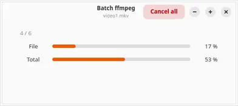

# batch_ffmpeg

Encodes a list of videos with ffmpeg, one after another, in a GTK 4 window with two progress bars
(the current file and the whole run) and a single Cancel button.



```sh
batch_ffmpeg.py video*.mkv -- -c:v libx264 -crf 20 -preset slow
```

Everything after `--` is forwarded to ffmpeg


Needs `ffmpeg`, `ffprobe`, and Python 3 with PyGObject (GTK 4 + libadwaita).

## TODO
- add time remaining approx
